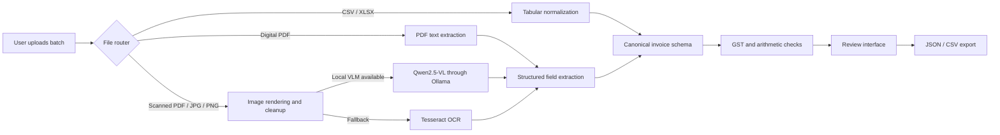

# VYOM+ VyomSure — Invoice Intelligence

> **Qualifier proposal only.** This GitHub repository must contain only this `README.md`. The rules prohibit source code, datasets, notebooks, binaries, generated files, and other implementation files during the qualifier. The working implementation is maintained separately for the final round.

## 1. Project Name

**VYOM+ VyomSure — Local-First GST Invoice Intelligence**

## 2. Problem Statement

Small businesses and accounting teams receive GST invoices as scans, phone photographs, digital PDFs, and spreadsheets. Handwritten fields and inconsistent layouts make manual transcription slow and error-prone. Generic OCR can misread GSTINs and amounts, and a text-recognition demo does not validate whether the extracted financial record is usable. We will build a document-intelligence pipeline that converts these inputs into reviewable GST records and highlights uncertainty before downstream accounting use.

## 3. Project Overview

VyomSure accepts PDF, JPEG/JPG, PNG, CSV, and XLSX invoices. It routes each file to a suitable local processing path, extracts invoice and line-item fields, normalizes them, runs deterministic GST and arithmetic checks, and presents the result with confidence and review reasons. Its distinctive focus is local vision-language assistance for handwritten Indian invoices, paired with a transparent fallback and human review.

## 4. Proposed Solution

A browser upload workspace calls a Python API. Digital PDF text and spreadsheet data are parsed directly. Scanned documents are rendered/preprocessed locally, then transcribed with an open-weight vision-language model through Ollama when available, or Tesseract OCR as a fallback. A structured extraction stage produces canonical JSON. A validation layer checks GSTIN shape, tax-total consistency, missing values, and selected intra/inter-state anomalies. The user reviews and exports corrected/structured records as JSON or CSV.

## 5. Objectives

- Accept the five required input families: XLSX, CSV, PDF, JPEG/JPG, and PNG.
- Improve handwritten-field extraction with a local vision-language model.
- Preserve source text and field-level uncertainty for review.
- Detect malformed GSTINs, amount mismatches, and incomplete records.
- Produce standardized records that can be evaluated and extended into accounting workflows.
- Keep invoice data on the user's machine during inference.

## 6. Target Users / Use Case

The primary users are small-business bookkeepers, accountants, and finance operations teams handling mixed-quality invoice batches. A reviewer uploads a batch, inspects flagged rows and source text, then exports the validated records for another accounting step. The prototype does not automatically file returns or post entries.

## 7. Open-Source AI Technology Selected

**Qwen2.5-VL 3B**, run locally through **Ollama**, is the selected vision-language component. It transcribes images with handwriting context and returns schema-oriented invoice fields. **Tesseract OCR 5** provides an open-source local fallback for OCR. Python rule-based extraction remains available when a local VLM is not installed.

## 8. Why This Technology Was Selected

The challenge calls out handwritten GST invoice processing. A vision-language model accepts the invoice image itself, so it can use spatial context between labels, handwritten values, and line items instead of relying solely on isolated OCR tokens. A small quantized local model is appropriate for a hackathon demonstration and avoids sending financial documents to a hosted model API. Tesseract keeps the pipeline usable on machines without a compatible vision model. The exact model tag, hardware, latency, and field accuracy will be recorded during evaluation; no accuracy claim is assumed in advance.

## 9. AI's Role in the System

The VLM handles two focused tasks: handwriting-aware transcription and structured field extraction across invoice context. It is not used to decide tax law or silently repair uncertain values. Deterministic code validates extracted GSTIN format and arithmetic; low-confidence or inconsistent records are flagged for human verification. This split makes model contribution visible while keeping key checks reproducible.

## 10. System Architecture



## 11. Component-Level Architecture

| Component | Responsibility | Why it is needed |
|---|---|---|
| Web UI | Upload, progress, record table, detail review, export | Gives evaluators a working, inspectable workflow |
| FastAPI service | Upload validation, routing, JSON endpoints | Separates interface from document processing |
| Input router | Dispatch by extension and content path | Avoids treating spreadsheets, text PDFs, and photos identically |
| PDF/tabular readers | Extract embedded PDF text; parse XLSX/CSV rows | Avoids needless OCR and retains structured source information |
| Local OCR/VLM | Read scanned and handwritten image content | Addresses the track's document-intelligence and handwriting challenge |
| Canonical extractor | Map available values to stable invoice fields | Produces machine-readable downstream records |
| Validator | Apply GSTIN-format, arithmetic, completeness, anomaly checks | Makes errors and uncertainty actionable and auditable |
| Exporter | Emit JSON and CSV | Supports programmatic evaluation and downstream integration |

## 12. Data / Information Flow

1. The browser accepts files up to a defined size limit and sends them to the local API.
2. The router validates the file type and selects spreadsheet, embedded-PDF-text, or OCR processing.
3. Image/PDF pages are preprocessed locally. The local VLM is preferred for handwritten content when enabled; otherwise the pipeline uses Tesseract OCR.
4. Extracted content is normalized into invoice number/date, parties, GSTINs, tax values, totals, currency, and line items where available.
5. Validation adds explicit success, warning, error, or review messages. The source filename, OCR engine, and available source text are retained.
6. The UI displays records and lets the reviewer export JSON/CSV.

## 13. Agentic Workflow (if applicable)

No autonomous agent is required. The workflow is a bounded pipeline with explicit stages and no open-ended tool access. Model calls are restricted to image transcription and field extraction; deterministic validators and a human review gate control what leaves the system. This is easier to reproduce and evaluate than an agent loop for a fixed document-processing task.

## 14. Technology Stack

- Python 3.10+
- FastAPI and Uvicorn
- Qwen2.5-VL 3B served locally with Ollama (optional runtime installation)
- Tesseract OCR 5 and pytesseract fallback
- pandas and openpyxl for CSV/XLSX
- pdfplumber and PyMuPDF for digital/scanned PDFs
- Pillow and Requests for image preprocessing and local inference transport
- HTML, CSS, and JavaScript browser interface

## 15. Expected Features

- Multi-file upload for PDF, JPEG/JPG, PNG, CSV, and XLSX.
- Handwriting boost toggle and local-model readiness indicator.
- Invoice fields, confidence, OCR engine, source, and validation badges.
- Searchable record table and a detail view with extracted text.
- GSTIN format and taxable-plus-tax versus total checks.
- JSON and CSV exports.
- Built-in sample record for a reproducible UI walkthrough.
- Safe incomplete output: missing or unreadable values remain empty and are flagged, not fabricated.

## 16. Implementation Approach

1. Define a canonical record schema and common spreadsheet header aliases.
2. Build input validation and per-format routing.
3. Implement PDF text extraction and spreadsheet normalization.
4. Add image preprocessing, local VLM prompt/schema, and Tesseract fallback.
5. Add deterministic validation and review statuses.
6. Build the upload/review/export interface and sample flow.
7. Evaluate on a held-out set with printed and handwritten documents reported separately; measure field coverage, exact-match rates, amount error, review rate, and inference time.

## 17. Expected Final Output

For each document, the system returns a JSON record with invoice identifier/date, seller and buyer, GSTINs, taxable value, CGST/SGST/IGST, total, line items when recoverable, confidence, source, OCR engine, and validation messages. Spreadsheet rows retain original source fields. The interface also downloads a JSON array or flattened CSV. Example shape:

```json
{
  "invoice_number": "MH-2026-1042",
  "invoice_date": "2026-09-18",
  "seller_gstin": "27AABCS1234F1Z5",
  "taxable_value": 6400.0,
  "cgst": 576.0,
  "sgst": 576.0,
  "total_amount": 7552.0,
  "confidence": 0.82,
  "validation": [{"level": "success", "message": "GSTIN and amount checks passed"}]
}
```

## 18. Future Scope / Scalability

- Add field-level corrections and capture reviewed labels for a consented evaluation set.
- Support more Indian invoice layouts, regional languages, and GST-specific line-item checks.
- Add OCR bounding boxes and source-region highlighting for auditability.
- Add background jobs, batch queues, and object storage only for an explicitly secured deployment.
- Connect exports to accounting software through controlled adapters after human approval.
- Benchmark smaller VLMs, quantization, and CPU/GPU inference for practical deployment.

## 19. Open-Source Dependencies / Components

| Component | Use |
|---|---|
| Qwen2.5-VL 3B + Ollama | Local image understanding and structured extraction; verify upstream model license before redistribution |
| Tesseract 5 + pytesseract | OCR fallback |
| FastAPI + Uvicorn | Local HTTP service |
| pandas + openpyxl | Tabular input parsing |
| pdfplumber + PyMuPDF | PDF text extraction and scanned-page rendering |
| Pillow + Requests | Image preprocessing and localhost model requests |
| Project source | MIT License |

## 20. Expected Challenges and Mitigation

| Challenge | Mitigation |
|---|---|
| Handwriting and low-resolution images | Local VLM path, image cleanup, confidence/review flags, original text visibility |
| Similar-looking GSTIN characters and amounts | Format checks, amount reconciliation, never auto-correct uncertain characters |
| Diverse invoice layouts | Contextual extraction plus canonical schema; retain raw/source fields |
| Model latency and hardware variability | Small local model option, Tesseract fallback, record runtime/hardware during evaluation |
| False confidence or invented fields | Prompt for null on unreadable fields; deterministic validation and human review gate |
| Sensitive financial documents | Local inference, no hosted-model dependency, avoid storing files after request |
| Evaluation leakage | Separate held-out printed/handwritten invoices and publish reproducible field metrics |

---

### Qualifier checklist

- [x] Exactly one challenge selected: VYOM+ GST Invoice Intelligence.
- [x] All 20 required proposal sections included.
- [x] Open-source AI role and selection rationale explained.
- [x] Architecture, data flow, dependencies, implementation plan, risks, and expected output included.
- [x] This qualifier submission directory contains only `README.md`.
